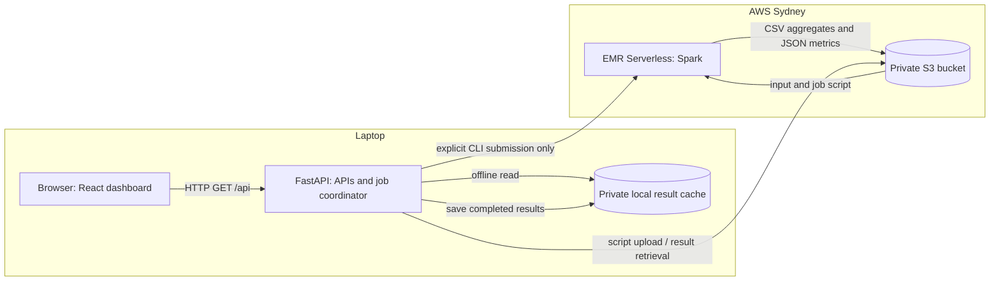
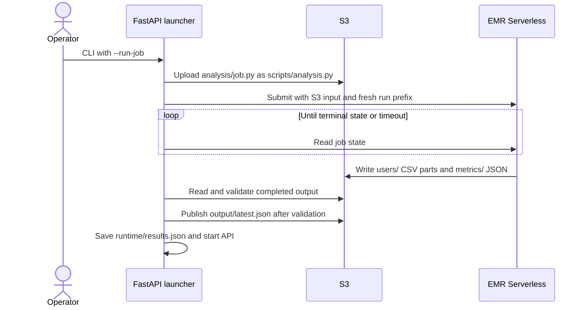

# Architecture

## Context and boundaries

This is a batch analytics application for one supplied dataset. AWS performs the
distributed computation; the laptop hosts the web application. The browser never
receives AWS credentials and never submits a cloud job.

## Components and code ownership

| Component | Responsibility | Source |
| --- | --- | --- |
| Frontend | Fetch counts, required-user cards, search, pagination and theme | `frontend/src/TwitterApp.tsx`, `components/ThemeToggle.tsx` |
| Backend | Configuration, explicit job submission, validated result loading and REST API | `backend/app.py` |
| Analysis | Clean and deduplicate edges; distributed count/join; write aggregate output | `analysis/job.py` |
| Infrastructure | Bucket protections, runtime role and EMR resource limits | `infra/` |
| Runtime packaging | Build React and serve it through a non-root Python container | `Dockerfile`, `compose.yaml` |
| Delivery | Offline checks/builds and manually requested GHCR image publishing | `.github/workflows/` |

## Batch execution and result publication

A fresh output prefix prevents stale parts from earlier runs being combined with
new output. Failed/cancelled jobs do not publish a new pointer. An interrupt,
polling failure or local wait timeout triggers cancellation of an unfinished job.
An EMR execution timeout limits runtime; capacity limits are not a spending cap.

Default startup retrieves saved S3 results. `--offline` reads the private local
cache. `--demo` uses the small test fixture and labels it as sample data. These
modes do not resubmit the analysis.

## Data semantics and contracts

For `src dst`, src follows dst. `dropDuplicates(["src", "dst"])` in
[`analysis/job.py`](../../analysis/job.py) removes repeated complete ordered pairs.
Grouping destinations counts followers; grouping sources counts followees. A full
outer join and zero fill retain one-sided users. Reciprocal pairs stay distinct;
self-loops contribute one on each side. IDs remain exact strings.

Spark validates that total followers = total followees = unique edges. The
backend additionally checks CSV columns, numeric IDs, nonnegative counts,
unique users, row totals and both degree sums before serving the result.

| Endpoint | Contract |
| --- | --- |
| `GET /api/health` | Ready state, metrics and result provenance |
| `GET /api/users?offset=0&limit=25` | Stable page and total; limit 1-200 |
| `GET /api/users/{id}` | Exact counts; 400 invalid ID, 404 absent ID |

S3 contains `input/`, `scripts/`, `output/runs/<run>/users/`,
`output/runs/<run>/metrics/`, `output/latest.json` and `logs/`.
The backend loads aggregate rows into memory once; requests do not scan the raw
dataset or contact EMR. A restart or new startup is required to load newer results.

## Deployment, access and operational limits

The Vite build is served by FastAPI. Docker exposes the same process on port 8000;
Compose binds it to laptop port 8002 and mounts completed results read-only.
Application credentials come from a local profile or the AWS credential chain.
The Spark runtime role is restricted to the project bucket's relevant prefixes.

The current app has no authentication and is intended for local use. For public
Fargate/EC2 hosting, add HTTPS, access control, task/instance roles, network rules,
logging and deployment permissions. A container can load saved S3 output at
startup. RDS is deferred: CSV/S3 plus a small in-memory index are sufficient for
this fixed dataset, and a database would require a separate storage design.

Terraform state, local configuration, credentials, raw data, dependencies and
result caches stay outside version control. GitHub CI cannot submit jobs or apply
infrastructure. Image publication is manual; no AWS deployment is configured.

See [ADR-0001](adr/0001-batch-analysis-and-local-web.md) and
[QA](../qa/README.md) for the decision and verification evidence.
