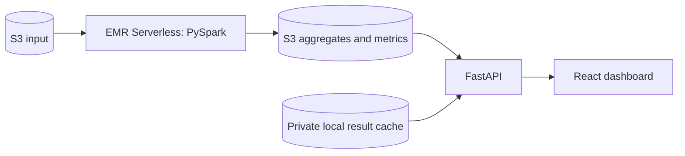

# SDD: twitter-network-analyzer

Status: implemented design. Updated: 17 October 2026.

## System and data flow

An explicit operator command uploads the analysis script, starts the cloud job,
validates its output and publishes a latest-result pointer. The backend can load
that completed S3 output or its private local copy. Browser requests read the
loaded aggregates; they do not submit cloud analysis.

## Modules and boundaries

| Module | Responsibility |
| --- | --- |
| `analysis/job.py` | Validate input, deduplicate directed pairs, aggregate and write results |
| `backend/app.py` | Coordinate explicit jobs, validate/load results and serve APIs/the built UI |
| `frontend/` | Display counts, featured users, search, pagination and themes |
| `infra/` | Define S3, IAM and EMR resources; no web hosting |

The web app runs locally or as one Docker container. S3 holds the durable cloud
output; a Git-ignored cache supports offline reuse. There is no relational
database. Public hosting is a separate [draft RFC](rfc/0001-hosted-dashboard.md).

See [architecture details](ARCHITECTURE.md) for failure handling and boundaries,
[ADR-0001](adr/0001-batch-analysis-and-local-web.md) for the accepted decision, and
[TSD](TSD.md) for developer contracts.
