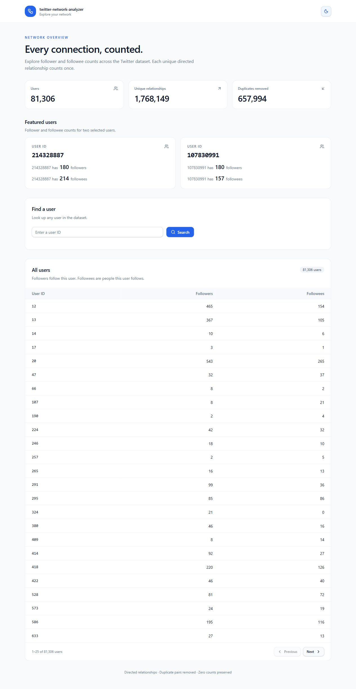
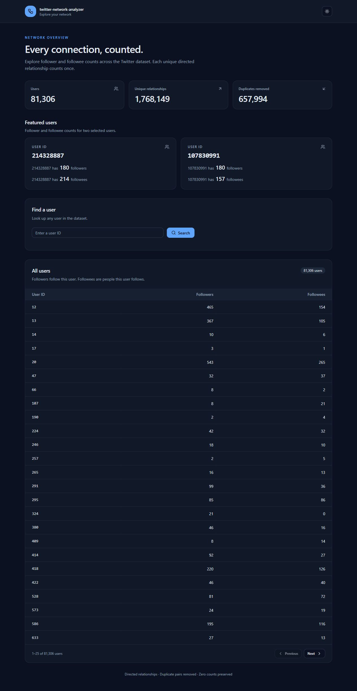

# User experience and visual evidence

## Layout and interaction

The dashboard follows one reading order: project name and theme control, dataset
totals, the two featured users, ID search, then a paginated table of all users.
Cards stack on narrow screens; the table keeps numeric columns aligned.

```text
twitter-network-analyzer                           [Theme]
Title and short explanation
[Users]              [Relationships]          [Duplicates]
[Featured user 214328887]       [Featured user 107830991]
[Find a user: numeric ID                         Search]
[All users: ID / Followers / Followees                  ]
[Page range                             Previous / Next]
```

Searching or changing a page only calls the API. There is no UI control that
submits an EMR job. The sample preview has a visible warning. Infrastructure status, region and
analysis time are kept in technical documentation and the health API. Errors remain near the affected operation.

The sun/moon button has an accessible action label, supports keyboard activation,
and stores the chosen theme. On first visit the page uses the system preference.
The initial theme is applied before React renders to avoid a bright flash.

## Screenshots

These are captures of the implemented application with the real completed EMR
results, not generated mock data. Captured 17 October 2026 after simplifying the
`twitter-network-analyzer` customer dashboard. Both required users
and their values are visible. Full-page images can be opened at original size.

| View | Artifact |
| --- | --- |
| Light theme | [Dashboard screenshot](screenshots/dashboard-light.jpg) |
| Dark theme | [Dashboard screenshot](screenshots/dashboard-dark.jpg) |
| Narrow mobile layout | [375px viewport screenshot](screenshots/dashboard-mobile.jpg) |

<details>
<summary>Light theme</summary>



</details>

<details>
<summary>Dark theme</summary>



</details>

## UX checks

Component tests cover counts, lookup validation, errors, page boundaries, sample
warnings and theme interaction. Browser-only checks such as responsive layout,
system theme and persistence across reloads are recorded separately in
[QA results](../qa/TEST-RESULTS.md). No formal accessibility certification or
cross-browser coverage is claimed.
